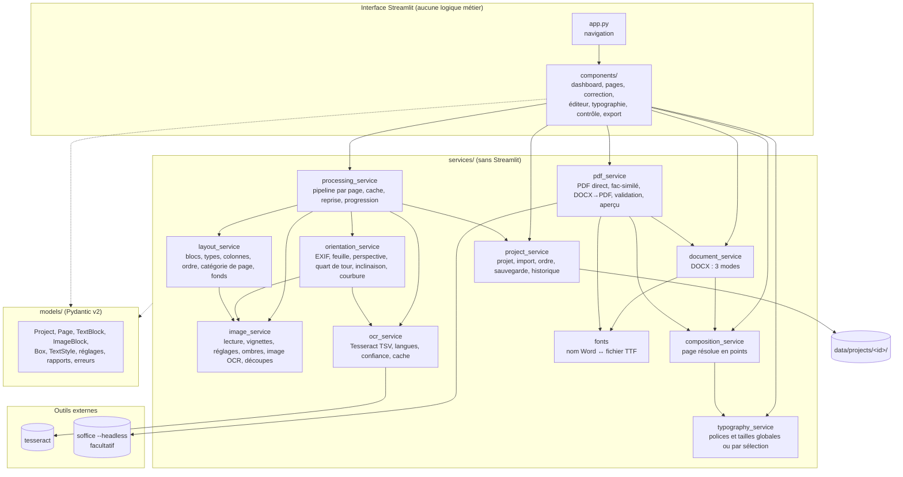

# Architecture

État : **contrat v1.1, 16/10/2026**. Les types exacts sont dans `models/` (testés par `tests/test_models.py`) ; en cas d'écart, `models/` fait foi. Ce document est la référence avant toute délégation. Propriétaire : `software-architect`.

## 1. Vue d'ensemble

Pipeline par page, non destructif. Chaque étape lit la précédente et écrit un résultat **séparé**, régénérable à partir de l'original et des paramètres enregistrés.

```
original ──► correction géométrique ──► image corrigée ──► (amélioration) ──► image OCR
                                             │                                    │
                                             │                              OCR Tesseract
                                             ▼                                    ▼
                                   illustrations / fond ◄──── analyse de mise en page ──► blocs
                                                                                    │
                                     typographie globale + format de page ─► composition (points)
                                                                                    │
                                                    ┌───────────────┬──────────────┼───────────────┐
                                                 aperçu PNG       DOCX           PDF direct     DOCX→PDF (LibreOffice)
```



Règles de dépendance (vérifiées en revue) : `components → services → models` ; `models` n'importe rien du projet ; aucun `import streamlit` hors de `app.py` et `components/` ; pas de cycle entre services (sens des flèches ci-dessus).

## 2. Arborescence

```
app.py                       point d'entrée Streamlit, navigation (st.navigation)
config.py                    réglages (variables d'environnement BOOKOCR_*), chemins, limites
models/
  errors.py                  BookOcrError et sous-classes (message utilisateur en français)
  geometry.py                Box, Quad, PageFormat
  blocks.py                  BlockKind, TextStyle, OcrWord, OcrLine, TextBlock, ImageBlock
  page.py                    PageCategory, GeometryCorrection, ImageEnhancement, PageStatus, Page
  project.py                 ReconstructionMode, TypographySettings, ExportSettings, Project
  reports.py                 Issue, ProcessingReport, ExportReport, ValidationReport
services/                    voir §5 (contrats)
components/                  écrans (screens/), widgets réutilisables (box_editor, sortable_pages, compare_view, crop_selector),
                             scan/ (fenêtres et éléments communs des écrans de numérisation, §12)
tests/                       pytest ; fixtures/synthetic.py (pages avec vérité terrain)
data/                        données de travail (exclu de Git)
docs/                        documentation technique
```

## 3. Format du projet persistant

```
data/projects/<project_id>/
  project.json               modèle Project complet (schema_version), écriture atomique
  project.json.bak           version précédente
  originals/<sha256[:16]>.<ext>  fichiers importés, stockés une fois, jamais réécrits (un PDF/TIFF multi-pages sert plusieurs pages)
  corrected/<page_id>.png    image après correction géométrique (régénérable)
  enhanced/<page_id>.png     image après réglages d'amélioration (régénérable, absente si réglages neutres)
  ocr_input/<page_id>.png    image envoyée à l'OCR (régénérable)
  images/<block_id>.png      illustrations extraites, PNG sans perte, pleine résolution
  backgrounds/<page_id>.png  fond de page reconstruit (texte effacé) pour les modes fidélité/hybride
  thumbs/<page_id>.jpg       vignettes
  cache/ocr/<clé>.json       résultats OCR (clé = image + langues + psm + version)
  ocr/<page_id>.json         dernier résultat OCR de la page (entrée de l'analyse de mise en page)
  history/<page_id>/<horodatage>.json   versions précédentes de la page (bornées)
  exports/                   DOCX, PDF et rapports de validation JSON
  trash/<page_id>/           pages supprimées ou sources remplacées (page.json + fichiers dérivés), récupérables
  project.json.corrupted     copie d'un project.json illisible (diagnostic), le .bak ayant été rouvert
  job.json                   état du traitement en arrière-plan
```

- Ordre des pages = ordre de `Project.pages` (liste). Réordonner ne renomme aucun fichier.
- Un fichier PDF importé donne une page par page du PDF (rasterisée par PyMuPDF à 300 dpi) ; `Page.source_file` et `Page.source_index` gardent la trace.
- `st.session_state` ne contient que l'état d'affichage et l'identifiant du projet ouvert ; les données vivent dans `project.json`.

## 4. Repère et unités

- **Coordonnées de bloc** : `Box(x, y, w, h)` normalisées 0..1 par rapport à l'**image corrigée** de la page (origine en haut à gauche).
- Une modification de la correction géométrique après l'OCR rend la page `ocr_outdated` (signature de géométrie différente) : l'interface propose de relancer.
- **Points typographiques** (1/72 po) seulement à partir de `composition_service`, qui projette les boîtes sur le format de page choisi.
- Tailles de police stockées en points **pour le format détecté** ; `composition_service` les met à l'échelle si l'utilisateur choisit un autre format (option « adapter les tailles »).

## 5. Contrats des services

Signatures v1. `→` = valeur de retour. Les erreurs levées sont des sous-classes de `BookOcrError` (`models/errors.py`).

### 5.1 `project_service` (intégration)

```python
project_dir(project_or_id) -> Path ; project_lock(project_id) -> threading.RLock   # verrou unique des écritures
create_project(name: str, languages: list[str] | None = None) -> Project
list_projects() -> list[ProjectSummary]
open_project(project_id: str) -> Project            # ProjectNotFoundError, ProjectCorruptedError
save_project(project: Project) -> None                                      # atomique ; .bak ; met à jour updated_at
import_files(project: Project, files: list[tuple[str, bytes]], position: int | None = None) -> ImportReport
    # formats : jpg/jpeg/png/tif/tiff (multi-pages)/pdf ; taille et pixels bornés ; doublons (SHA-256 + index) ignorés et signalés
replace_page_source(project: Project, page_id: str, name: str, data: bytes) -> Page   # garde l'ordre ; réinitialise les résultats de cette page seulement
delete_pages(project: Project, page_ids: list[str]) -> None                 # fichiers déplacés dans trash/, pas effacés
reorder_pages(project: Project, ordered_ids: list[str]) -> None
set_manual_rotation(project: Project, page_id: str, quarter_turns: int) -> Page
snapshot_page(project: Project, page_id: str, reason: str) -> str (id de version)         # appelé avant toute modification utilisateur
list_page_versions(project: Project, page_id: str) -> list[PageVersion]
restore_page_version(project: Project, page_id: str, version_id: str) -> Page
page_paths(project: Project, page: Page) -> PagePaths                       # chemins absolus de toutes les versions d'image
update_page(project, page, reason=None) -> None                              # API des éditeurs (instantané si reason)
should_autosave(project, last_saved_monotonic, now_monotonic) -> bool ; load_thumbnail ; load_original
```

### 5.2 `processing_service` (intégration)

```python
process_pages(project: Project, page_ids: list[str] | None, steps: set[Step],
              progress: Callable[[ProgressEvent], None] | None = None,
              cancel: threading.Event | None = None) -> ProcessingReport
    # Step = GEOMETRY | ENHANCE | OCR | LAYOUT ; page par page ; save_project après chaque page (reprise possible)
    # une erreur sur une page la met en PageStatus.ERROR avec le message, et le lot continue
start_background_job(project_id: str, page_ids, steps) -> str               # un seul job par projet ; état dans data/projects/<id>/job.json
job_status(project_id: str) -> JobStatus | None
```

### 5.3 `orientation_service` (OCR et image)

```python
detect_orientation(rgb: ndarray) -> OrientationResult        # quarter_turns 0..3 (horaire), confidence, method ("osd"|"reading"|"none"), uncertain: bool
detect_page_quad(rgb: ndarray) -> QuadResult | None         # 4 coins normalisés + score ; None si pas de feuille nette
estimate_skew(gray: ndarray, max_angle: float = 10.0) -> SkewResult   # angle (°, antihoraire), confidence, uncertain
estimate_curvature(gray: ndarray) -> CurvatureResult        # modèle de déformation + fiabilité ; jamais appliqué si uncertain
correct_page(original_rgb: ndarray, settings: GeometryCorrection, detect: bool = True) -> GeometryOutcome
    # GeometryOutcome(image, applied: GeometryCorrection (valeurs retenues), warnings: list[Issue])
    # detect=False rejoue exactement les valeurs enregistrées (reproductible)
```

### 5.4 `image_service` (OCR et image)

```python
read_image(path: Path, source_index: int = 0) -> ndarray     # RGB uint8, EXIF appliqué ; ImageReadError
inspect_upload(name: str, data: bytes) -> list[SourceItem]   # pages contenues, format réel, taille ; UnsupportedFileError
write_png(rgb: ndarray, path: Path) -> None                  # refuse un chemin sous originals/
thumbnail(rgb: ndarray, max_side: int = 320) -> ndarray
enhance(rgb: ndarray, settings: ImageEnhancement) -> ndarray # réglages neutres → tableau identique
correct_shadows(rgb: ndarray, strength: float) -> ndarray    # division par le fond estimé, illustrations protégées
prepare_ocr_image(rgb: ndarray, illustration_boxes: list[Box] = ()) -> ndarray   # gris, éclairage égalisé
crop_box(rgb: ndarray, box: Box, padding: float = 0.0) -> ndarray
erase_text_regions(rgb: ndarray, boxes: list[Box], method: Literal["inpaint", "fill"]) -> ndarray   # fond « reconstruit », marqué estimé
```

### 5.5 `ocr_service` (OCR et image)

```python
available_languages() -> list[str]                           # sans "osd"
check_languages(languages: list[str]) -> None                # OcrUnavailableError avec commande d'installation
run_ocr(gray: ndarray, languages: list[str], psm: int = 3, cache_dir: Path | None = None) -> OcrResult
    # OcrResult(words: list[OcrWord] (boîtes normalisées + conf), width, height, languages, engine_version, mean_confidence)
ocr_region(gray: ndarray, box: Box, languages: list[str]) -> tuple[str, float]   # relecture d'un bloc corrigé à la main
class OcrEngine(Protocol): name; version(); recognize(gray, languages, psm) -> OcrResult   # PaddleOCR enfichable plus tard
```

### 5.6 `layout_service` (mise en page)

```python
analyse_page(ocr: OcrResult, corrected_rgb: ndarray, settings: LayoutSettings) -> LayoutResult
    # LayoutResult(text_blocks, image_blocks (sans fichier), category: PageCategory, columns: int,
    #              margins: Box, printed_page_number: str | None, background_regions: list[Box],
    #              detected_format: PageFormat, body_font_size_pt: float, issues: list[Issue])
detect_illustrations(corrected_rgb: ndarray, text_boxes: list[Box]) -> list[DetectedRegion]
reading_order(blocks: list[TextBlock | ImageBlock]) -> list[str]   # identifiants dans l'ordre
merge_layout(previous: Page, fresh: LayoutResult) -> Page          # garde les blocs corrigés/créés par l'utilisateur
```

### 5.7 `typography_service` (mise en page)

```python
apply_global_typography(project: Project, change: TypographyChange, page_ids: list[str] | None = None,
                        override_individual: bool = False) -> TypographyReport
    # TypographyChange : police document/titres/corps, tailles, interligne, alignement, marges, espacements (champs None = inchangés)
    # override_individual=False : les blocs ayant une surcharge manuelle du même attribut sont laissés et comptés dans le rapport
preview_typography_change(project, change, page_ids) -> TypographyReport   # même calcul, sans écrire
resolve_style(project: Project, block: TextBlock) -> ResolvedStyle         # style de bloc ← surcharge ← style du type ← global
```

### 5.8 `composition_service` (mise en page) — source unique de l'aperçu et des exports

```python
compose_page(project: Project, page: Page, mode: ReconstructionMode) -> ComposedPage
    # ComposedPage(width_pt, height_pt, margins_pt, background: ImageElement | None,
    #              elements: list[TextElement | ImageElement] dans l'ordre de lecture, columns: list[ColumnBand], issues)
    # TextElement : rect_pt, texte final (corrigé sinon OCR), ResolvedStyle, kind, z_index, positioning ("flow"|"absolute")
compose_book(project: Project, mode: ReconstructionMode, page_ids: list[str] | None = None) -> list[ComposedPage]
```

### 5.9 `document_service` (DOCX et PDF)

```python
build_docx(pages: list[ComposedPage], project: Project, mode: ReconstructionMode, output: Path) -> ExportReport
    # styles Word réutilisables ; 1 section par page ; sauts de page explicites ; images ; fonds ; replis listés dans le rapport
inspect_docx(path: Path) -> DocxInspection                  # relecture : sections, paragraphes par style, images, cadres, ancres
```

### 5.10 `pdf_service` (DOCX et PDF)

```python
render_pdf(pages: list[ComposedPage], output: Path, searchable_facsimile: bool = False) -> ExportReport
    # rendu direct PyMuPDF : texte réel, polices TTF intégrées ; débordements mesurés (insert_htmlbox)
render_preview(page: ComposedPage, width_px: int = 900) -> tuple[Image.Image, list[Issue]]   # = rendu PDF rasterisé
convert_docx_to_pdf(docx: Path, output_dir: Path, timeout: int = 180) -> ConversionResult  # LibreOffice ; available=False si absent
validate_pdf(path: Path, expected: list[ComposedPage]) -> ValidationReport
    # pages (nombre, tailles), texte par page (similarité), images, pages blanches, polices non intégrées
```

### 5.11 `fonts` (DOCX et PDF)

```python
available_families() -> dict[str, FontFamily]                # familles TTF trouvées (regular, bold, italic, bold-italic)
font_file(family: str, bold: bool, italic: bool) -> Path     # repli explicite et signalé (Liberation Serif / Sans)
missing_glyphs(family: str, text: str) -> set[str]
```

## 6. Modèle de données (résumé ; détail dans `models/`)

| Modèle | Champs principaux |
|---|---|
| `Project` | `schema_version`, `id`, `name`, `created_at`, `updated_at`, `languages`, `pages: list[Page]`, `typography: TypographySettings`, `export: ExportSettings`, `autosave_seconds` |
| `Page` | `id`, `source_file`, `source_index`, `source_sha256`, `original_name`, `manual_rotation`, `geometry: GeometryCorrection`, `enhancement: ImageEnhancement`, `status`, `category`, `detected_format`, `format_override`, `text_blocks`, `image_blocks`, `background_regions`, `printed_page_number`, `ocr_signature`, `issues`, `mean_confidence` |
| `TextBlock` | `id`, `kind: BlockKind`, `box: Box`, `ocr_text`, `corrected_text` (None = non corrigé), `lines: list[OcrLine]`, `confidence`, `needs_review`, `estimated_style: TextStyle`, `style_override: TextStyle` (champs optionnels), `on_image`, `user_created`, `hidden`, `order` |
| `ImageBlock` | `id`, `kind` (`photo`, `illustration`, `background`, `table_image`), `box`, `file` (relatif au projet), `caption_block_id`, `crop`, `user_created`, `hidden`, `order` |
| `TextStyle` | `font_family`, `font_size_pt`, `bold`, `italic`, `underline`, `color`, `alignment`, `line_spacing`, `space_before_pt`, `space_after_pt`, `first_line_indent_pt`, `left_indent_pt`, `right_indent_pt` (tous optionnels dans une surcharge) |
| `BlockKind` | `heading_1`, `heading_2`, `paragraph`, `list_item`, `caption`, `header`, `footer`, `page_number`, `note`, `table`, `special` |
| `PageCategory` | `text`, `graphic_background`, `photo_text`, `text_on_image`, `mixed`, `unknown` |
| `ReconstructionMode` | `fidelity`, `editable`, `hybrid` (voir TECHNICAL_DECISIONS D-06) |

## 6 bis. Responsabilités transverses précisées (v1.1)

- `processing_service` écrit les fichiers dérivés après l'analyse : `images/<block_id>.png` (découpe de l'image corrigée ; si des blocs `on_image` la recouvrent, le texte y est effacé et la découpe brute est gardée dans `images/<block_id>_raw.png`), `backgrounds/<page_id>_<n>.png` pour chaque `Page.background_regions[n]` (texte effacé selon `Project.background_method`).
- `composition_service` ne lit aucun pixel : il convertit les boîtes en points, résout les styles (`typography_service.resolve_style`) et décide du `positioning` selon le mode (D-06). Il ne dépend pas de `fonts`.
- `ComposedPage.backgrounds` (liste) précède tous les éléments ; `TextElement.positioning` vaut `flow`, `absolute`, `header` ou `footer`.
- Page non analysée : `ComposedPage.analysed = False`, sans élément ; les exports produisent une page vide signalée, jamais la photo.

## 7. Traitement long et interface

Le traitement par lots s'exécute dans un thread d'arrière-plan (`processing_service.start_background_job`) qui enregistre le projet après chaque page et l'avancement dans `job.json`. L'interface lit cet état avec un fragment Streamlit rafraîchi périodiquement : elle reste utilisable, et un redémarrage de Streamlit ne perd que la page en cours de calcul.

## 8. Numérisation intelligente (PDF fidèle recherchable, Gemma 3 facultatif) — contrat v1, 19/10/2026

Objectif : un **PDF par livre** dont le contenu visible est la **photographie traitée** (couleurs conservées, jamais une image générée) avec une **couche OCR invisible** alignée mot par mot. Ce module est séparé de la reconstruction DOCX ; il réutilise le projet (`project_service` : originaux SHA-256, ordre des pages), la géométrie (`orientation_service.correct_page` via `processing_service.run_geometry`, qui écrit `corrected/<page>.png`), les réglages (`image_service.enhance`) et l'OCR (`ocr_service.run_ocr`). Modèles : `models/scanning.py` (fait foi).

```
original (EXIF) ─► run_geometry (OpenCV : feuille validée, perspective, quart de tour OSD, inclinaison) ─► corrected/<p>.png
                         │
                         ├─► copie réduite 896 px ─► Gemma 3 (Ollama, facultatif, cache) ─► VisualAnalysis (validée)
                         ▼
          mesures ImageMetrics ─► plan_adjustments(mesures, analyse) ─► ScanAdjustments (bornés)
                         ▼
          apply_adjustments ─► contrôle avant/après (QualityCheck) ─► scan/<p>/final.jpg (ou page redressée si dégradée)
                         ▼
          prepare_ocr_image + Tesseract (cache) ─► scan/<p>/ocr.json (mots, boîtes normalisées sur final.jpg)
                         ▼
          build_searchable_pdf (une page = final.jpg inséré sans recompression + mots en rendu 3) ─► validation + rapport JSON
```

### 8.1 Fichiers

```
data/projects/<id>/scan/<page_id>/record.json   ScanPageRecord (réglages, historique, analyse, mesures, chemins)
data/projects/<id>/scan/<page_id>/final.jpg     image finale couleur (seul encodage JPEG, qualité 92, 4:4:4)
data/projects/<id>/scan/<page_id>/ocr.json      OcrResult sur final.jpg
data/projects/<id>/scan/analysis/<clé>.json     cache AnalysisRecord (clé = sha256 image envoyée + modèle/digest + version du prompt)
data/projects/<id>/exports/<nom>_numerisation.pdf  (+ .validation.json)
data/bookocr.db, table scan_tasks               file persistante : état par page (PENDING … FAILED), tentatives, erreur
```

### 8.2 `ollama_service` (intégration) — transport HTTP local, aucune dépendance Streamlit

```python
status() -> OllamaStatus                       # existant : désactivé / injoignable / modèle absent / disponible
model_details(model: str | None = None, timeout: float = 5) -> OllamaModelInfo   # /api/show : digest, capacités (vision)
chat_json(prompt: str, image_jpeg: bytes, schema: dict, *, model: str | None = None,
          timeout: float | None = None, retries: int | None = None) -> OllamaChatResult
    # POST /api/chat, images base64, format = schéma JSON, temperature 0, stream False.
    # Sémaphore global OLLAMA_MAX_PARALLEL_REQUESTS ; nouvelles tentatives bornées (OLLAMA_MAX_RETRIES)
    # seulement sur délai dépassé / erreur réseau / HTTP 5xx. Lève AiUnavailableError (désactivé, injoignable,
    # modèle absent, HTTP 4xx), AiTimeoutError, AiResponseError (JSON absent ou illisible). Ne télécharge jamais.
```

### 8.3 `image_analysis_service` (intégration) — Gemma comme assistant d'analyse uniquement

```python
PROMPT_VERSION: str
analysis_image(rgb: np.ndarray, max_side: int = config.OLLAMA_ANALYSIS_MAX_SIDE) -> bytes   # JPEG réduit, copie
analyse_page(rgb: np.ndarray, cache_dir: Path, *, force: bool = False) -> AnalysisRecord
    # cache par empreinte ; ne lève pas : statut "disabled" / "unavailable" / "timeout" / "invalid_response" / "error"
    # avec message ; le pipeline continue sans IA.
```

### 8.4 `image_quality_service` (OCR et image) — mesures, aucune décision IA

```python
measure(rgb: np.ndarray) -> ImageMetrics
    # mesures tonales sur l'intérieur de la page (bandes de fond exclues) : clarté du papier (p90),
    # étendue tonale (p98 − p2), écrêtage, couleur (Hasler), éclairage du fond, bruit (Immerkær),
    # inclinaison résiduelle, encre au bord, largeur des bandes de fond par bord (dark_edges)
compare(before: np.ndarray, after: np.ndarray, before_metrics: ImageMetrics | None = None) -> QualityCheck
    # passed=False et enhancement_degraded=True si l'amélioration dégrade : netteté effondrée, écrêtage accru,
    # dérive chromatique (a*b*) excessive, couleurs atténuées, contraste effondré, contenu apparu au bord.
    # Un changement de clarté voulu (exposition) n'est pas une dérive. Les scores ne « prouvent » pas un gain.
```

### 8.5 `image_enhancement` (OCR et image) — transformations OpenCV/Pillow déterministes

```python
apply_adjustments(rgb: np.ndarray, adjustments: ScanAdjustments) -> np.ndarray
    # copie ; neutre = identité ; ordre : rognage par bord, ombres/contraste (image_service.enhance),
    # exposition (gain), gamma et luminosité, débruitage/contraste local/netteté (image_service.enhance) ;
    # jamais de binarisation ni de passage en gris
plan_adjustments(metrics: ImageMetrics, analysis: VisualAnalysis | None = None) -> AdjustmentPlan
    # chaque action de Gemma n'est retenue que si une mesure la confirme ; sans analyse : mesures seules
    # (seuils plus stricts). Page correcte : plan neutre. ROTATE / PERSPECTIVE / DETECT_PAGE ne règlent rien
    # ici : ils deviennent des motifs de vérification (review_required) si la géométrie OpenCV ne les confirme pas.
crop_edges(rgb: np.ndarray, adjustments: ScanAdjustments) -> np.ndarray   # crop_left/top/right/bottom
```

### 8.6 `pdf_export` (DOCX et PDF) — PDF fidèle recherchable

```python
build_searchable_pdf(pages: list[SearchablePageInput], output: Path, dpi: int = config.SCAN_PDF_DPI) -> SearchablePdfReport
    # une page PDF par entrée, dans l'ordre ; taille = pixels × 72 / dpi ; JPEG inséré tel quel (pas de
    # recompression, pas de rotation : le JPEG n'a pas d'EXIF) ; chaque mot OCR écrit en rendu 3 (invisible),
    # étiré horizontalement à la largeur de sa boîte ; aucun texte blanc ; écriture atomique.
validate_searchable_pdf(path: Path, pages: list[SearchablePageInput], probes_per_page: int = 3) -> SearchablePdfValidation
    # nombre de pages, texte extractible, couche texte 100 % invisible, recherche de mots OCR connus,
    # flux image identique au JPEG, écart de couleur rendu/final.
```

### 8.7 `scanning_service` (intégration) et `scan_repository`, `workers/scan_runner`

```python
sync_queue(project: Project) -> None                     # une ligne scan_tasks par page, ordre = Project.pages
load_record(project, page) -> ScanPageRecord ; save_record(project, record) -> None   # écriture atomique
analyse(project, page_id, force: bool = False) -> ScanPageRecord          # Gemma sur la page redressée
process_page(project, page_id, *, use_ai: bool | None = None, auto_apply: bool | None = None,
             redetect: bool = False, reanalyse: bool = False, regeometry: bool = False) -> ScanPageRecord
    # la page redressée existante est réutilisée si la géométrie n'a pas changé ; le statut DOCX est conservé
    # géométrie -> (analyse) -> plan -> rendu final -> contrôle -> OCR ; état COMPLETED / REVIEW_REQUIRED / FAILED
render_final(project, page_id, adjustments: ScanAdjustments, source: str = "manual") -> ScanPageRecord
preview(project, page_id, adjustments, max_side=1400) -> (avant, après, QualityCheck)   # copie réduite, sans écriture
auto_enhance(project, page_id) ; redetect_geometry(project, page_id) ; set_rotation(project, page_id, quarts)
apply_proposal(project, page_id) -> ScanPageRecord ; restore_previous(project, page_id) ; reset_to_original(project, page_id)
set_manual_quad(project, page_id, corners) -> ScanPageRecord                # recadrage manuel validé géométriquement
validate_page(project, page_id, validated: bool = True) -> ScanPageRecord
export_book_pdf(project, *, require_validation: bool = False) -> tuple[SearchablePdfReport, SearchablePdfValidation]
book_overview(project) -> list[dict]                      # tableau de l'écran
scan_runner.start(book_ids, page_ids=None, *, retry_failed=False, use_ai=None) ; cancel() ; is_running() ; status()
scan_runner.run_book(book_id, page_ids=None, *, retry_failed=False, use_ai=None, cancel_event=None, workers=None)
scan_runner.worker_count(use_ai, requested=None) -> int     # config.SCAN_WORKERS (≥ 1) ; 1 avec Gemma
scan_runner.is_page_busy(page_id) -> bool                   # RunnerStatus.current_pages
    # un seul worker de numérisation par processus ; livres traités l'un après l'autre ; dans un livre,
    # `workers` pages à la fois dans des fils du même processus (verrou project_lock valable dans un processus,
    # donc pas de processus séparés) ; seconds_per_page = durée écoulée / pages faites (débit réel)
```

Écran : `components/screens/smart_scan.py` (« Numérisation intelligente », groupe Traitement ; voir §12). Déroulé :
1. livre (existant ou nouveau) et toutes ses photos (téléversement ou dossier local) ;
2. un bouton lance le traitement en arrière-plan ;
3. galerie avant/après avec les modifications (`describe_changes`) ;
4. retouche d'une page ;
5. PDF du livre.

Compléments v1.1 (19/10) :
- `page_bounds.detect_paper_quad(rgb)` : secours de `orientation_service._detect_sheet` par la couleur du papier. Il intervient seulement si le contour clair-sur-sombre est absent ou incertain, s'il y a du fond sur au moins 3 côtés, et avec un recouvrement ≥ 80 % si un contour incertain existe.
- `ScanAdjustments.paper_whitening` et `image_enhancement.whiten_paper` : nettoyage du fond.
- `ImageMetrics.dark_edges` : bande sombre, rangées sans papier (2,5 % au plus) ou ligne du vrai bord de page (4 % au plus).
- `pdf_export.build_searchable_pdf(..., uniform=True)` : pages de même format, images ajustées et centrées.
- `scanning_service.create_book`, `import_book_files` (ordre naturel), `import_book_folder`, `describe_changes`, `export_book_pdf(..., uniform=True)`.

Compléments v1.2 (19/10, suppression du fond) :
- `ScanBookSettings` (`remove_background`, `center_content`), dans `scan/settings.json` (`load_book_settings`, `save_book_settings`, `requeue_book`).
- `ScanAdjustments.background_removal` et `image_enhancement.remove_background(rgb, strength)`, `image_regions(rgb)` ; `plan_adjustments(..., remove_background=True)`.
- `image_quality_service.content_box(rgb) -> Box | None` ; `compare(..., background_removed=True)` (pas d'écrêtage compté sur le papier, dérive de teinte mesurée dans les images).
- `ScanPageRecord.content_box`, `SearchablePageInput.content_box` : centrage du bloc de contenu dans `build_searchable_pdf(uniform=True)`.

Compléments v1.3 (19/10, pages sombres) : `orientation_service._detect_sheet` essaie, dans l'ordre, trois détecteurs :
1. `detect_page_quad`, feuille claire sur fond sombre ;
2. `page_bounds.detect_paper_quad`, couleur du papier, réservé aux papiers clairs (clarté Lab ≥ 110) ;
3. `page_bounds.detect_line_quad`, bords droits alignés, seulement si aucun contour n'a été trouvé (code `quad_from_lines`).

Règles : Gemma ne fixe jamais de coordonnées ni de rotation ; une orientation incertaine (OSD) ou contredite par Gemma passe la page en `REVIEW_REQUIRED` sans rotation ; `OLLAMA_AUTO_APPLY=false` (défaut) : le traitement applique le plan **mesuré** et range le plan Gemma dans `proposed_plan` (aperçu puis validation) ; `true` : le plan combiné est appliqué, les incertitudes passent en vérification. Les originaux ne sont jamais réécrits ; chaque réglage est un paramètre rejoué depuis la page redressée.


## 9. Gestion des projets, statistiques et prix (19/10/2026)

```python
project_service.update_project_details(project_id, *, name, author=None, expected_page_count=None, languages=None) -> Project
project_service.trash_project(project_id) -> str        # déplace data/projects/<id> vers data/trash/projects/<id>_<horodatage>
project_service.list_trashed_projects() -> list[TrashedProject] ; project_service.restore_project(trash_name) -> Project
scanning_service.delete_book(project_id) -> str         # refusé pendant un traitement ; retire les lignes scan_tasks
scanning_service.restore_book(trash_name) -> Project    # reconstruit les états de file depuis les record.json
scanning_service.classify_page(final_rgb) -> (PageKind, part_images)
    # priorité : couverture (pas de papier clair, p90 < 90, ou images ≥ 60 %) ; tableau (has_table : ≥ 3 traits fins
    # horizontaux et verticaux, ≥ 9 croisements) ; avec image(s) (images ≥ 3 %) ; sinon texte seul
scanning_service.set_page_kind(project, page_id, kind | None) ; scanning_service.book_statistics(project) -> BookScanStats
pricing_service.load_prices() / save_prices(PricingSettings) ; pricing_service.estimate(stats, prices) -> BookPriceEstimate
```

Seules les pages `COMPLETED` (traitement fini, ou page à vérifier validée) sont comptées. Le type effectif est le type corrigé par l'utilisateur s'il existe, sinon le type détecté. Écrans : tableau de bord (gestion des projets), « Prix » (groupe Projet), étape 6 de « Numérisation intelligente ».

## 10. PDF du livre en un clic, validation en bloc, OCR facultatif (23/10/2026)

```python
ScanBookSettings: run_ocr, remove_background, center_content, uniform_pages, include_unvalidated, auto_export
scanning_service.validate_all(project) -> ValidateAllSummary(validated, already, not_ready)   # numéros de page
scanning_service.export_book_pdf(project, *, include_unvalidated=None, uniform=None, center_content=None,
                                 automatic=False)    # défauts = réglages du livre ; écrit <nom>.pdf,
                                                     # <nom>.validation.json et <nom>.export.json (BookPdfExport)
scanning_service.latest_book_pdf(project) -> BookPdfExport | None
scanning_service.is_export_current(project, export, settings=None) -> bool   # export_signature(project, settings)
scanning_service.export_problems(project, settings=None) -> list[str]        # vide : le PDF peut être créé
scanning_service.auto_export_if_ready(project) -> BookPdfExport | None       # appelé par scan_runner en fin de lot
```

- `export_signature` : ordre des pages, `final_signature`, `ocr_signature`, présence de l'OCR, bloc de contenu, options. L'état « validé » ne compte que si les pages non validées sont exclues.
- `run_ocr=False` : `_ocr` n'est pas lancé, `ScanPageRecord.ocr_skipped=True` et la page est à jour sans `ocr.json`. Si l'OCR est réactivé, ces pages apparaissent dans `export_problems` (« retraitez le livre »).


## 11. Format de sortie et modifications en bloc (23/10/2026)

```python
ScanBookSettings.page_format     # "image" | "median" | "A3" | "A4" | "A5" | "B5" | "Letter" | "Legal" | "custom"
ScanBookSettings.orientation     # "auto" (chaque page suit sa photo) | "portrait" | "landscape"
ScanBookSettings.margin_mm, custom_width_mm, custom_height_mm ; paper_size_mm (propriété) ; uniform_pages (propriété)
pdf_export.build_searchable_pdf(..., uniform=False, paper_mm=None, orientation="auto", margin_mm=None)
ScanAdjustments.extra_left/top/right/bottom   # rognage supplémentaire, appliqué après crop_* ; gardé au retraitement
scanning_service.apply_quad_to_pages(project, corners | None, page_ids=None) -> list[str]      # pages modifiées
scanning_service.apply_rotation_to_pages(project, quarter_turns, page_ids=None) -> list[str]
scanning_service.apply_trim_to_pages(project, {"left"|"top"|"right"|"bottom": fraction} | None, page_ids=None) -> list[str]
```

L'écran lance ensuite `scan_runner.start([livre], pages_modifiées, use_ai=False)`. Comme la géométrie ou l'image finale ont changé, `process_page` refait la géométrie (rejouée, sans nouvelle détection), le rendu et l'OCR. Le PDF automatique est recréé en fin de lot.


## 12. Écran de numérisation et regroupement des boutons (23/10/2026)

Navigation inchangée dans la barre latérale (`st.navigation`, groupes Projet, Traitement, Mise en page, Livre). L'écran `components/screens/smart_scan.py` garde ses six étapes ; les boutons d'un même objectif sont sur une même ligne :

| Étape | Groupe de boutons |
|---|---|
| 1. Livre et photos | options de traitement (OCR, fond, Gemma) puis bouton de traitement |
| 2. Traitement | relancer les erreurs, arrêter |
| 3. Résultats | affichage (galerie, tableau), filtre, valider toutes les pages ; tableau : traiter la sélection, retoucher la sélection |
| 4. Retouche | choix de la page, retoucher cette page, modifier toutes les pages |
| 5. PDF du livre | mise en page (format, orientation, marge, centrage) et options d'export ; créer / télécharger / recréer |

Modules de l'écran (`components/scan/`, sans logique métier) :
- `shared.py` : libellés et constantes, état de Gemma (`ai_status`, testé et mis en cache), `use_ai`, `cached_image`, `run_action`, `runner_caption`, `rerun_when_runner_stops` ;
- `retouch.py` : fenêtre « Retoucher la page » (`open_retouch(page_id)`, `show_if_open(project)`). Chaque outil porte ses boutons : Aperçu (traiter, valider), Recadrage (nouvelle détection des bords, contour automatique), Réglages (améliorer automatiquement, original, réglages précédents, enregistrer), Orientation et type, Analyse Gemma (analyser, appliquer la proposition) ;
- `bulk.py` : fenêtre « Modifier toutes les pages » (`open_bulk()`, `show_if_open(project)`), §11.

Une fenêtre s'ouvre par une clé de session (`retouch.DIALOG_KEY`, `bulk.DIALOG_KEY`) lue en fin d'écran.
