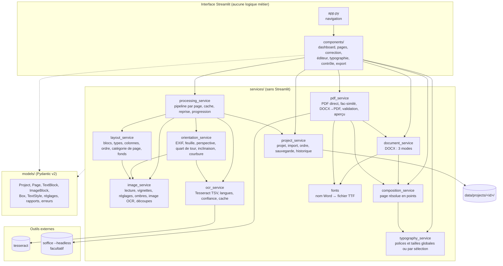

# Architecture

État : **contrat v1.1, 16/10/2026**. Les types exacts sont dans `models/` (testés par `tests/test_models.py`) ; en cas d'écart, `models/` fait foi. Ce document est la référence avant toute délégation. Propriétaire : `software-architect`.

## 1. Vue d'ensemble

Pipeline par page, non destructif. Chaque étape lit la précédente et écrit un résultat **séparé**, régénérable à partir de l'original et des paramètres enregistrés.

```
original ──► correction géométrique ──► image corrigée ──► (amélioration) ──► image OCR
                                             │                                    │
                                             │                              OCR Tesseract
                                             ▼                                    ▼
                                   illustrations / fond ◄──── analyse de mise en page ──► blocs
                                                                                    │
                                     typographie globale + format de page ─► composition (points)
                                                                                    │
                                                    ┌───────────────┬──────────────┼───────────────┐
                                                 aperçu PNG       DOCX           PDF direct     DOCX→PDF (LibreOffice)
```



Règles de dépendance (vérifiées en revue) : `components → services → models` ; `models` n'importe rien du projet ; aucun `import streamlit` hors de `app.py` et `components/` ; pas de cycle entre services (sens des flèches ci-dessus).

## 2. Arborescence

```
app.py                       point d'entrée Streamlit, navigation (st.navigation)
config.py                    réglages (variables d'environnement BOOKOCR_*), chemins, limites
models/
  errors.py                  BookOcrError et sous-classes (message utilisateur en français)
  geometry.py                Box, Quad, PageFormat
  blocks.py                  BlockKind, TextStyle, OcrWord, OcrLine, TextBlock, ImageBlock
  page.py                    PageCategory, GeometryCorrection, ImageEnhancement, PageStatus, Page
  project.py                 ReconstructionMode, TypographySettings, ExportSettings, Project
  reports.py                 Issue, ProcessingReport, ExportReport, ValidationReport
services/                    voir §5 (contrats)
components/                  un module par écran + widgets réutilisables (box_editor, sortable_pages, compare_view)
tests/                       pytest ; fixtures/synthetic.py (pages avec vérité terrain)
data/                        données de travail (exclu de Git)
docs/                        documentation technique
```

## 3. Format du projet persistant

```
data/projects/<project_id>/
  project.json               modèle Project complet (schema_version), écriture atomique
  project.json.bak           version précédente
  originals/<sha256[:16]>.<ext>  fichiers importés, stockés une fois, jamais réécrits (un PDF/TIFF multi-pages sert plusieurs pages)
  corrected/<page_id>.png    image après correction géométrique (régénérable)
  enhanced/<page_id>.png     image après réglages d'amélioration (régénérable, absente si réglages neutres)
  ocr_input/<page_id>.png    image envoyée à l'OCR (régénérable)
  images/<block_id>.png      illustrations extraites, PNG sans perte, pleine résolution
  backgrounds/<page_id>.png  fond de page reconstruit (texte effacé) pour les modes fidélité/hybride
  thumbs/<page_id>.jpg       vignettes
  cache/ocr/<clé>.json       résultats OCR (clé = image + langues + psm + version)
  ocr/<page_id>.json         dernier résultat OCR de la page (entrée de l'analyse de mise en page)
  history/<page_id>/<horodatage>.json   versions précédentes de la page (bornées)
  exports/                   DOCX, PDF et rapports de validation JSON
  trash/<page_id>/           pages supprimées ou sources remplacées (page.json + fichiers dérivés), récupérables
  project.json.corrupted     copie d'un project.json illisible (diagnostic), le .bak ayant été rouvert
  job.json                   état du traitement en arrière-plan
```

- Ordre des pages = ordre de `Project.pages` (liste). Réordonner ne renomme aucun fichier.
- Un fichier PDF importé donne une page par page du PDF (rasterisée par PyMuPDF à 300 dpi) ; `Page.source_file` et `Page.source_index` gardent la trace.
- `st.session_state` ne contient que l'état d'affichage et l'identifiant du projet ouvert ; les données vivent dans `project.json`.

## 4. Repère et unités

- **Coordonnées de bloc** : `Box(x, y, w, h)` normalisées 0..1 par rapport à l'**image corrigée** de la page (origine en haut à gauche).
- Une modification de la correction géométrique après l'OCR rend la page `ocr_outdated` (signature de géométrie différente) : l'interface propose de relancer.
- **Points typographiques** (1/72 po) seulement à partir de `composition_service`, qui projette les boîtes sur le format de page choisi.
- Tailles de police stockées en points **pour le format détecté** ; `composition_service` les met à l'échelle si l'utilisateur choisit un autre format (option « adapter les tailles »).

## 5. Contrats des services

Signatures v1. `→` = valeur de retour. Les erreurs levées sont des sous-classes de `BookOcrError` (`models/errors.py`).

### 5.1 `project_service` (intégration)

```python
project_dir(project_or_id) -> Path ; project_lock(project_id) -> threading.RLock   # verrou unique des écritures
create_project(name: str, languages: list[str] | None = None) -> Project
list_projects() -> list[ProjectSummary]
open_project(project_id: str) -> Project            # ProjectNotFoundError, ProjectCorruptedError
save_project(project: Project) -> None                                      # atomique ; .bak ; met à jour updated_at
import_files(project: Project, files: list[tuple[str, bytes]], position: int | None = None) -> ImportReport
    # formats : jpg/jpeg/png/tif/tiff (multi-pages)/pdf ; taille et pixels bornés ; doublons (SHA-256 + index) ignorés et signalés
replace_page_source(project: Project, page_id: str, name: str, data: bytes) -> Page   # garde l'ordre ; réinitialise les résultats de cette page seulement
delete_pages(project: Project, page_ids: list[str]) -> None                 # fichiers déplacés dans trash/, pas effacés
reorder_pages(project: Project, ordered_ids: list[str]) -> None
set_manual_rotation(project: Project, page_id: str, quarter_turns: int) -> Page
snapshot_page(project: Project, page_id: str, reason: str) -> str (id de version)         # appelé avant toute modification utilisateur
list_page_versions(project: Project, page_id: str) -> list[PageVersion]
restore_page_version(project: Project, page_id: str, version_id: str) -> Page
page_paths(project: Project, page: Page) -> PagePaths                       # chemins absolus de toutes les versions d'image
update_page(project, page, reason=None) -> None                              # API des éditeurs (instantané si reason)
should_autosave(project, last_saved_monotonic, now_monotonic) -> bool ; load_thumbnail ; load_original
```

### 5.2 `processing_service` (intégration)

```python
process_pages(project: Project, page_ids: list[str] | None, steps: set[Step],
              progress: Callable[[ProgressEvent], None] | None = None,
              cancel: threading.Event | None = None) -> ProcessingReport
    # Step = GEOMETRY | ENHANCE | OCR | LAYOUT ; page par page ; save_project après chaque page (reprise possible)
    # une erreur sur une page la met en PageStatus.ERROR avec le message, et le lot continue
start_background_job(project_id: str, page_ids, steps) -> str               # un seul job par projet ; état dans data/projects/<id>/job.json
job_status(project_id: str) -> JobStatus | None
```

### 5.3 `orientation_service` (OCR et image)

```python
detect_orientation(rgb: ndarray) -> OrientationResult        # quarter_turns 0..3 (horaire), confidence, method ("osd"|"reading"|"none"), uncertain: bool
detect_page_quad(rgb: ndarray) -> QuadResult | None         # 4 coins normalisés + score ; None si pas de feuille nette
estimate_skew(gray: ndarray, max_angle: float = 10.0) -> SkewResult   # angle (°, antihoraire), confidence, uncertain
estimate_curvature(gray: ndarray) -> CurvatureResult        # modèle de déformation + fiabilité ; jamais appliqué si uncertain
correct_page(original_rgb: ndarray, settings: GeometryCorrection, detect: bool = True) -> GeometryOutcome
    # GeometryOutcome(image, applied: GeometryCorrection (valeurs retenues), warnings: list[Issue])
    # detect=False rejoue exactement les valeurs enregistrées (reproductible)
```

### 5.4 `image_service` (OCR et image)

```python
read_image(path: Path, source_index: int = 0) -> ndarray     # RGB uint8, EXIF appliqué ; ImageReadError
inspect_upload(name: str, data: bytes) -> list[SourceItem]   # pages contenues, format réel, taille ; UnsupportedFileError
write_png(rgb: ndarray, path: Path) -> None                  # refuse un chemin sous originals/
thumbnail(rgb: ndarray, max_side: int = 320) -> ndarray
enhance(rgb: ndarray, settings: ImageEnhancement) -> ndarray # réglages neutres → tableau identique
correct_shadows(rgb: ndarray, strength: float) -> ndarray    # division par le fond estimé, illustrations protégées
prepare_ocr_image(rgb: ndarray, illustration_boxes: list[Box] = ()) -> ndarray   # gris, éclairage égalisé
crop_box(rgb: ndarray, box: Box, padding: float = 0.0) -> ndarray
erase_text_regions(rgb: ndarray, boxes: list[Box], method: Literal["inpaint", "fill"]) -> ndarray   # fond « reconstruit », marqué estimé
```

### 5.5 `ocr_service` (OCR et image)

```python
available_languages() -> list[str]                           # sans "osd"
check_languages(languages: list[str]) -> None                # OcrUnavailableError avec commande d'installation
run_ocr(gray: ndarray, languages: list[str], psm: int = 3, cache_dir: Path | None = None) -> OcrResult
    # OcrResult(words: list[OcrWord] (boîtes normalisées + conf), width, height, languages, engine_version, mean_confidence)
ocr_region(gray: ndarray, box: Box, languages: list[str]) -> tuple[str, float]   # relecture d'un bloc corrigé à la main
class OcrEngine(Protocol): name; version(); recognize(gray, languages, psm) -> OcrResult   # PaddleOCR enfichable plus tard
```

### 5.6 `layout_service` (mise en page)

```python
analyse_page(ocr: OcrResult, corrected_rgb: ndarray, settings: LayoutSettings) -> LayoutResult
    # LayoutResult(text_blocks, image_blocks (sans fichier), category: PageCategory, columns: int,
    #              margins: Box, printed_page_number: str | None, background_regions: list[Box],
    #              detected_format: PageFormat, body_font_size_pt: float, issues: list[Issue])
detect_illustrations(corrected_rgb: ndarray, text_boxes: list[Box]) -> list[DetectedRegion]
reading_order(blocks: list[TextBlock | ImageBlock]) -> list[str]   # identifiants dans l'ordre
merge_layout(previous: Page, fresh: LayoutResult) -> Page          # garde les blocs corrigés/créés par l'utilisateur
```

### 5.7 `typography_service` (mise en page)

```python
apply_global_typography(project: Project, change: TypographyChange, page_ids: list[str] | None = None,
                        override_individual: bool = False) -> TypographyReport
    # TypographyChange : police document/titres/corps, tailles, interligne, alignement, marges, espacements (champs None = inchangés)
    # override_individual=False : les blocs ayant une surcharge manuelle du même attribut sont laissés et comptés dans le rapport
preview_typography_change(project, change, page_ids) -> TypographyReport   # même calcul, sans écrire
resolve_style(project: Project, block: TextBlock) -> ResolvedStyle         # style de bloc ← surcharge ← style du type ← global
```

### 5.8 `composition_service` (mise en page) — source unique de l'aperçu et des exports

```python
compose_page(project: Project, page: Page, mode: ReconstructionMode) -> ComposedPage
    # ComposedPage(width_pt, height_pt, margins_pt, background: ImageElement | None,
    #              elements: list[TextElement | ImageElement] dans l'ordre de lecture, columns: list[ColumnBand], issues)
    # TextElement : rect_pt, texte final (corrigé sinon OCR), ResolvedStyle, kind, z_index, positioning ("flow"|"absolute")
compose_book(project: Project, mode: ReconstructionMode, page_ids: list[str] | None = None) -> list[ComposedPage]
```

### 5.9 `document_service` (DOCX et PDF)

```python
build_docx(pages: list[ComposedPage], project: Project, mode: ReconstructionMode, output: Path) -> ExportReport
    # styles Word réutilisables ; 1 section par page ; sauts de page explicites ; images ; fonds ; replis listés dans le rapport
inspect_docx(path: Path) -> DocxInspection                  # relecture : sections, paragraphes par style, images, cadres, ancres
```

### 5.10 `pdf_service` (DOCX et PDF)

```python
render_pdf(pages: list[ComposedPage], output: Path, searchable_facsimile: bool = False) -> ExportReport
    # rendu direct PyMuPDF : texte réel, polices TTF intégrées ; débordements mesurés (insert_htmlbox)
render_preview(page: ComposedPage, width_px: int = 900) -> tuple[Image.Image, list[Issue]]   # = rendu PDF rasterisé
convert_docx_to_pdf(docx: Path, output_dir: Path, timeout: int = 180) -> ConversionResult  # LibreOffice ; available=False si absent
validate_pdf(path: Path, expected: list[ComposedPage]) -> ValidationReport
    # pages (nombre, tailles), texte par page (similarité), images, pages blanches, polices non intégrées
```

### 5.11 `fonts` (DOCX et PDF)

```python
available_families() -> dict[str, FontFamily]                # familles TTF trouvées (regular, bold, italic, bold-italic)
font_file(family: str, bold: bool, italic: bool) -> Path     # repli explicite et signalé (Liberation Serif / Sans)
missing_glyphs(family: str, text: str) -> set[str]
```

## 6. Modèle de données (résumé ; détail dans `models/`)

| Modèle | Champs principaux |
|---|---|
| `Project` | `schema_version`, `id`, `name`, `created_at`, `updated_at`, `languages`, `pages: list[Page]`, `typography: TypographySettings`, `export: ExportSettings`, `autosave_seconds` |
| `Page` | `id`, `source_file`, `source_index`, `source_sha256`, `original_name`, `manual_rotation`, `geometry: GeometryCorrection`, `enhancement: ImageEnhancement`, `status`, `category`, `detected_format`, `format_override`, `text_blocks`, `image_blocks`, `background_regions`, `printed_page_number`, `ocr_signature`, `issues`, `mean_confidence` |
| `TextBlock` | `id`, `kind: BlockKind`, `box: Box`, `ocr_text`, `corrected_text` (None = non corrigé), `lines: list[OcrLine]`, `confidence`, `needs_review`, `estimated_style: TextStyle`, `style_override: TextStyle` (champs optionnels), `on_image`, `user_created`, `hidden`, `order` |
| `ImageBlock` | `id`, `kind` (`photo`, `illustration`, `background`, `table_image`), `box`, `file` (relatif au projet), `caption_block_id`, `crop`, `user_created`, `hidden`, `order` |
| `TextStyle` | `font_family`, `font_size_pt`, `bold`, `italic`, `underline`, `color`, `alignment`, `line_spacing`, `space_before_pt`, `space_after_pt`, `first_line_indent_pt`, `left_indent_pt`, `right_indent_pt` (tous optionnels dans une surcharge) |
| `BlockKind` | `heading_1`, `heading_2`, `paragraph`, `list_item`, `caption`, `header`, `footer`, `page_number`, `note`, `table`, `special` |
| `PageCategory` | `text`, `graphic_background`, `photo_text`, `text_on_image`, `mixed`, `unknown` |
| `ReconstructionMode` | `fidelity`, `editable`, `hybrid` (voir TECHNICAL_DECISIONS D-06) |

## 6 bis. Responsabilités transverses précisées (v1.1)

- `processing_service` écrit les fichiers dérivés après l'analyse : `images/<block_id>.png` (découpe de l'image corrigée ; si des blocs `on_image` la recouvrent, le texte y est effacé et la découpe brute est gardée dans `images/<block_id>_raw.png`), `backgrounds/<page_id>_<n>.png` pour chaque `Page.background_regions[n]` (texte effacé selon `Project.background_method`).
- `composition_service` ne lit aucun pixel : il convertit les boîtes en points, résout les styles (`typography_service.resolve_style`) et décide du `positioning` selon le mode (D-06). Il ne dépend pas de `fonts`.
- `ComposedPage.backgrounds` (liste) précède tous les éléments ; `TextElement.positioning` vaut `flow`, `absolute`, `header` ou `footer`.
- Page non analysée : `ComposedPage.analysed = False`, sans élément ; les exports produisent une page vide signalée, jamais la photo.

## 7. Traitement long et interface

Le traitement par lots s'exécute dans un thread d'arrière-plan (`processing_service.start_background_job`) qui enregistre le projet après chaque page et l'avancement dans `job.json`. L'interface lit cet état avec un fragment Streamlit rafraîchi périodiquement : elle reste utilisable, et un redémarrage de Streamlit ne perd que la page en cours de calcul.
